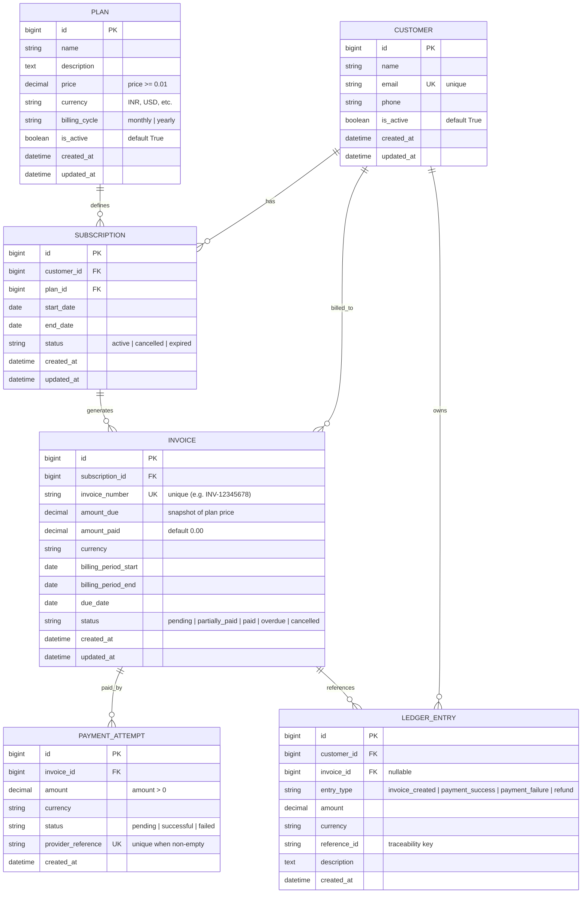
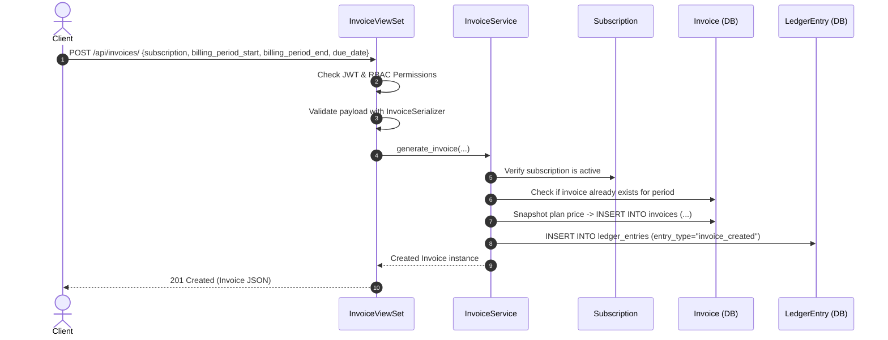
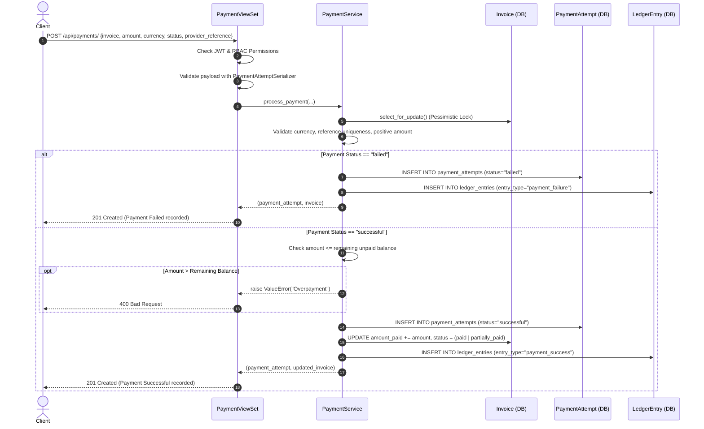

# SubLedger — Low-Level Design (LLD) Document

## 1. System Overview & Architecture

**SubLedger** is a simplified, production-grade SaaS subscription and billing backend built with **Django**, **Django REST Framework (DRF)**, and **PostgreSQL**.

The architecture adheres strictly to clean separation of concerns:
```
[ Client / Postman / Swagger ]
              │
              ▼
    Routes & ViewSets (`billing/views.py`, `billing/urls.py`)
              │  (Authentication & Role-Based Permissions)
              ▼
    Serializers (`billing/serializers.py`)
              │  (Data Validation & Serialization)
              ▼
    Service Layer (`billing/services/`)
              │  (Core Business Logic & Transactions)
              ▼
    Models & Database (`billing/models.py` + PostgreSQL)
              │  (Relational Persistence & Integrity Constraints)
              ▼
    Immutable Ledger (`LedgerEntry`)
```

---

## 2. Entity-Relationship Diagram (ERD)



---

## 3. Service Layer Responsibility Table

The **Service Layer** encapsulates all domain business logic, state machines, and transactional integrity:

| Service | Primary Method(s) | Key Responsibilities & Invariants Enforced |
| :--- | :--- | :--- |
| **`SubscriptionService`** | `create_subscription(...)` | • Rejects subscription to inactive plans.<br>• Prevents duplicate active subscriptions for the same customer and plan.<br>• Initializes subscription in `active` status within an atomic transaction. |
| **`InvoiceService`** | `generate_invoice(...)` | • Validates that subscription status is `active`.<br>• Enforces `billing_period_start <= billing_period_end`.<br>• Prevents duplicate invoices for the same subscription and billing period.<br>• Snapshots plan price into `amount_due` at generation time.<br>• Generates unique invoice number.<br>• Automatically creates an immutable `invoice_created` ledger entry. |
| **`PaymentService`** | `process_payment(...)` | • Acquires row-level lock (`select_for_update`) on invoice to prevent race conditions.<br>• Rejects payment amounts `<= 0`.<br>• Validates payment currency matches invoice currency.<br>• Rejects reused provider references.<br>• Prevents payments on already fully paid invoices.<br>• Prevents overpayments (`amount > amount_due - amount_paid`).<br>• For successful payments: updates `amount_paid`, updates status (`partially_paid` or `paid`), and writes `payment_success` ledger entry.<br>• For failed payments: preserves invoice balance and writes `payment_failure` ledger entry. |

---

## 4. Repository / Data Layer Table

Data access is managed through Django's model managers and ORM query encapsulation, ensuring optimal querying and query isolation:

| Entity / Model | Encapsulated Query Methods | Purpose & Invariants |
| :--- | :--- | :--- |
| **`Plan`** | `Plan.objects.all()`, `filter(is_active=True)` | Manages plan catalog and active status flags. |
| **`Customer`** | `Customer.objects.all()`, `get(email=...)` | Enforces email uniqueness and customer profile management. |
| **`Subscription`** | `filter(customer=..., plan=..., status='active')` | Validates single active subscription invariant per `(customer, plan)`. |
| **`Invoice`** | `filter(subscription=..., billing_period_start=..., billing_period_end=...)`, `select_for_update()` | Prevents billing period duplicates and ensures safe concurrent payment updates via pessimistic locking. |
| **`PaymentAttempt`**| `filter(provider_reference=...)` | Guarantees payment idempotency by verifying reference uniqueness. |
| **`LedgerEntry`** | `filter(customer=...)`, `create(...)` | **Strictly append-only**. Records financial audit trail; no `update` or `delete` operations are ever performed. |

---

## 5. Business-Rule Ownership Matrix

| # | Business Rule | Primary Enforcement Layer | Secondary / Database Enforcement |
| :--- | :--- | :--- | :--- |
| **BR-1** | Plan price must be positive (`price >= 0.01`). | `PlanSerializer` + Model validator | `MinValueValidator(Decimal("0.01"))` |
| **BR-2** | Customer email must be unique. | `CustomerSerializer` | `email = models.EmailField(unique=True)` |
| **BR-3** | Subscriptions cannot be created for inactive plans. | `SubscriptionService.create_subscription()` | Validation error returned as HTTP 400 |
| **BR-4** | A customer cannot have two active subscriptions to the same plan. | `SubscriptionService.create_subscription()` | Business guard query before insert |
| **BR-5** | Invoice `amount_due` must snapshot plan price at generation time. | `InvoiceService.generate_invoice()` | Stored directly in `Invoice.amount_due` column |
| **BR-6** | Invoices cannot be duplicated for the same subscription and period. | `InvoiceService.generate_invoice()` | `UniqueConstraint(fields=['subscription', 'billing_period_start', 'billing_period_end'])` |
| **BR-7** | Payments cannot exceed remaining unpaid balance (`amount_due - amount_paid`). | `PaymentService.process_payment()` | Validation error returned as HTTP 400 |
| **BR-8** | Failed payment must not change `amount_paid` or status. | `PaymentService.process_payment()` | Controlled branching; ledger logged with `payment_failure` |
| **BR-9** | Ledger entries are strictly append-only and traceable via `reference_id`. | `LedgerEntry` creation in Services | No update/delete endpoints exist in views or services |
| **BR-10**| Reused payment provider reference must be rejected. | `PaymentService.process_payment()` | `UniqueConstraint` on `provider_reference` |

---

## 6. Software Design Patterns Applied

1. **Service Layer Pattern:**
   * Keeps views thin (only handling HTTP, authentication, and serializer delegation) and models focused on schema definition.
   * Business rules (e.g., overpayment prevention, snapshotting pricing) are centralized in testable services.

2. **Append-Only Immutable Financial Ledger Pattern:**
   * Financial transactions are never updated or deleted. Every event (`invoice_created`, `payment_success`, `payment_failure`) generates a distinct chronological record.
   * Guarantees complete auditability and reconciliation.

3. **Pessimistic Locking Pattern (`select_for_update`):**
   * During payment processing, the invoice row is locked inside an atomic database transaction.
   * Prevents double-spending or race conditions when concurrent payment webhooks arrive simultaneously.

4. **Role-Based Access Control (RBAC) Pattern:**
   * Uses Django groups (`Admin`, `Billing Manager`, `Viewer`) to enforce granular authorization via `BillingRolePermission`.
   * Admins have full access; Managers have read/write without delete; Viewers are read-only; anonymous requests are blocked.

---

## 7. Core Sequence Flows

### Flow 1: Invoice Generation (`POST /api/invoices/`)



---

### Flow 2: Payment Processing (`POST /api/payments/`)



